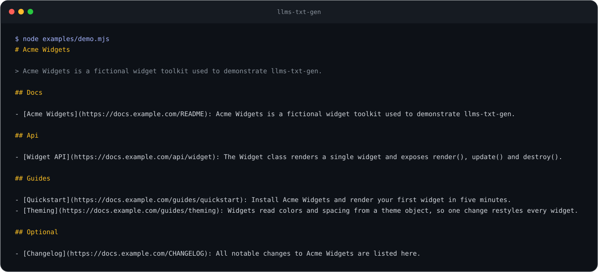

# llms-txt-gen

[](https://github.com/YusufBeratZengin/llms-txt-gen/actions/workflows/ci.yml) [](https://www.npmjs.com/package/llms-txt-gen) [](LICENSE) [](package.json)

English | [Türkçe](README.tr.md)

Generate and validate `llms.txt` (and `llms-full.txt`) from a repository or a folder of Markdown docs.
It has zero dependencies, runs fully offline, and needs no config file.

```sh
npm i -g llms-txt-gen   # or: npx llms-txt-gen
llms-txt-gen ./docs --base-url https://example.com/docs --full --max-tokens 50000
llms-txt-gen check ./docs/llms.txt
```

## Demo



The real output of `node examples/demo.mjs`, which runs the generator on the sample folder in [`examples/site`](examples/site):

```text
# Acme Widgets

> Acme Widgets is a fictional widget toolkit used to demonstrate llms-txt-gen.

## Docs

- [Acme Widgets](https://docs.example.com/README): Acme Widgets is a fictional widget toolkit used to demonstrate llms-txt-gen.

## Api

- [Widget API](https://docs.example.com/api/widget): The Widget class renders a single widget and exposes render(), update() and destroy().

## Guides

- [Quickstart](https://docs.example.com/guides/quickstart): Install Acme Widgets and render your first widget in five minutes.
- [Theming](https://docs.example.com/guides/theming): Widgets read colors and spacing from a theme object, so one change restyles every widget.

## Optional

- [Changelog](https://docs.example.com/CHANGELOG): All notable changes to Acme Widgets are listed here.
```

## Install

```sh
npm install --save-dev llms-txt-gen     # project dependency
npx llms-txt-gen --help                 # one-off
```

Node.js 20 or newer. Before the first npm release, run it from a clone: `node bin/llms-txt-gen.mjs`.

## Usage

### CLI

```sh
llms-txt-gen [generate] [dir] [options]   # build llms.txt (default command)
llms-txt-gen check [file] [--strict]      # validate an llms.txt
```

| Option | Meaning |
| --- | --- |
| `-o, --out <file>` | Output path. Default: `<dir>/llms.txt`. |
| `--stdout` | Print `llms.txt` instead of writing it. |
| `--full` | Also write `llms-full.txt` (all content concatenated) next to `llms.txt`. |
| `--full-out <file>` | Path for `llms-full.txt` (implies `--full`). |
| `--max-tokens <n>` | Cap `llms-full.txt` at about `n` estimated tokens (implies `--full`). |
| `--base-url <url>` | Prefix for links. Without it, links are relative to each output file's directory (`--stdout`: input directory). |
| `--strip-ext` | Drop `.md` / `.mdx` from link paths (for sites that serve clean URLs). |
| `--title`, `--description` | Override the H1 and the summary blockquote. |
| `--include <glob>` | Files to include, repeatable. Default `**/*.md`, `**/*.mdx`. |
| `--exclude <glob>` | Files to skip, repeatable. Always skipped: `node_modules/`, dot-directories such as `.github/`, `llms.txt`, `llms-full.txt`, the output files. |
| `--optional <glob>` | Files for the `Optional` section, repeatable. Replaces the default set (`CHANGELOG*`, `CODE_OF_CONDUCT*`, `CONTRIBUTING*`, `SECURITY*`, `LICENSE*`, `README.*.md`). |

Globs support `*`, `**`, `?`, `{a,b}` and `[abc]`. A pattern without `/` matches at any depth (like `.gitignore`); a trailing `/` means a whole directory.

`check` exits `0` when there are no errors, `1` on errors (or on warnings with `--strict`), and `2` when the file cannot be read. Other commands exit `2` on usage errors.

### Library

```js
import { generate, check } from 'llms-txt-gen';

const { llmsTxt, llmsFull, fullTokens, truncated } = generate({
  dir: './docs',
  baseUrl: 'https://example.com/docs',
  full: true,
  maxTokens: 50_000,
});
console.log(check(llmsTxt)); // { ok: true, errors: [], warnings: [] }
```

Also exported: `scanFiles`, `buildUrl`, `estimateTokens`, `parseFrontMatter`, `extractMeta`, `stripInline`, `globToRegExp`, `createMatcher`. The package ships JSDoc types and is checked with `tsc --strict`.

## Examples

See [`examples/`](examples). Run `node examples/demo.mjs` to reproduce the output above.

## How it works

- **Project title and summary:** `--title` / `--description`, then the root README's H1 / `package.json` description / README's first paragraph, then the folder name.
- **Page title and note:** front matter `title` / `description`, otherwise the first H1 and the first prose paragraph (code blocks, lists, quotes, tables and badge rows are skipped). Notes are cut at 160 characters.
- **Sections:** the first directory of a file names its section (`guides/x.md` goes under `Guides`); top-level files go under `Docs`. Front matter `section: Name` overrides it. `optional: true` in front matter, or a match with `--optional`, moves a page to `Optional`, which is always last. Front matter `order: n` sorts pages; `draft: true` skips them. Output is deterministic.
- **llms-full.txt:** every page as `# Title`, a `Source:` line and its body (front matter removed), in the same order as `llms.txt`, so `Optional` pages come last.
- **`--max-tokens`:** the initial title and summary count toward the budget; if they do not fit, generation fails with an error. Whole pages are kept while they fit. The first page that does not fit is cut at a line boundary (if at least about 100 tokens remain) and marked with an HTML comment; everything after it is dropped. `llms.txt` still lists every page.
- **Token estimate:** about 4 characters per token for ASCII and 2 for other characters. It is a heuristic, not a model tokenizer; leave a safety margin.
- **check:** errors are a missing or non-first H1, list items in a section that do not start with a `[text](url)` link, empty link text or URL, and spaces in a URL. Warnings are a missing summary blockquote, several H1s, an H1 over 125 characters, empty or duplicate sections, H3+ headings, free text between list items, duplicate URLs, notes without a colon, wrong `Optional` casing or position.

## Standard notes and uncertainty

The format follows the [llmstxt.org](https://llmstxt.org/) proposal as read on 2026-10-23: only the H1 is required; then an optional blockquote, optional heading-free detail text, and H2 file lists of `- [name](url): notes`; `Optional` marks links that can be skipped. This tool does not verify against any official test suite, and the proposal may change. Points that are unclear or not covered by the proposal, and what this tool does about them:

- **Relative links.** The proposal's example uses absolute URLs and does not mention relative ones. Without `--base-url` this tool emits relative paths; set `--base-url` for anything you publish.
- **`llms-full.txt`.** It is a common convention, not part of the proposal text I checked. Its layout here is my own choice.
- **Several H1s, H3+ headings, free text inside a file-list section.** Not described by the proposal. `check` reports them as warnings, not errors.
- **Summary blockquote.** Optional in the proposal; `check` warns when it is missing because it is the recommended shape.
- **`Optional` casing.** Only the exact name `Optional` is treated as special; other casing is warned about.
- **Section names and ordering.** Chosen by this tool (directory based); the proposal prescribes none.

## Limitations

- Only Markdown (`.md`, `.mdx`) is read. MDX components and JSX are left as they are.
- Front matter is a flat `key: value` subset of YAML (no nesting, lists or multi-line values).
- Links point at the Markdown files; mapping them to your site's published URLs is up to `--base-url` and `--strip-ext`.
- No network access, no telemetry. Nothing is checked against live URLs.

## Development

```sh
git clone https://github.com/YusufBeratZengin/llms-txt-gen.git
cd llms-txt-gen
npm ci
npm run check    # lint + typecheck + tests with coverage
npm run demo     # regenerate docs/demo.svg
```

## Contributing

See [CONTRIBUTING.md](CONTRIBUTING.md) and the [Code of Conduct](CODE_OF_CONDUCT.md). Security reports: [SECURITY.md](SECURITY.md).

## License

[MIT](LICENSE)
